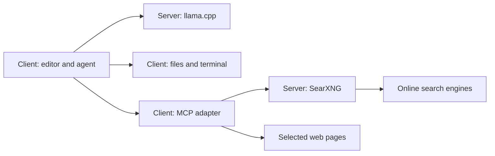

# Local LLM: server and clients

Run the model on a server with suitable GPU resources, then connect from an editor on any supported client device. Add SearXNG on the server for web search. One machine can be both server and client.

## What runs where

| Role | Runs here | Needs |
|---|---|---|
| Model server | llama.cpp, model weights, GPU inference | Hardware sized for the selected model and context |
| Search server | SearXNG, online search requests | Docker for this guide, CPU/RAM, internet access |
| Client | Code or Zed, project files, file edits, terminal commands | Editor and the project's development tools |
| Client search adapter | MCP search calls and page fetching | Node.js 22+ and npm for the documented Code integration |

A laptop is one possible client; a desktop works the same way. The client does not need a copy of the model or an inference GPU. Server and client operating systems can differ. Opening the model's browser chat does not grant it access to client files; the editor's agent tools perform those actions.

Project context is sent to the model server. Search queries reach online engines, and page reads contact the selected websites. The documented LAN services have no API authentication and use HTTP: use a trusted home network without router port forwarding.

## Setup order

| Step | Where | Guide |
|---|---|---|
| 1. Choose model and hardware | Planning | [Reality check](common/01-reality-check.md), [model choice](common/02-model-choice-and-speculation.md) |
| 2. Install the model service | Server | [Linux server](%5B02%5D%20Linux.md) or [Windows server](%5B01%5D%20Windows.md) |
| 3. Verify addresses and connectivity | Server and client | [Network access](common/05-network-access.md) |
| 4. Add search, if wanted | Server | [SearXNG server](common/06-search-server.md) — Arch/CachyOS installation |
| 5. Configure the editor and test tools | Each client | [Code OSS client + search MCP](common/04-code-oss-setup.md) or [Zed client](common/03-zed-setup.md) |

The Linux server instructions cover LAN access. The supplied Windows launchers currently serve localhost only. A Windows **client** can connect to the Linux server without installing the Windows server toolchain.

## Service addresses

Replace `SERVER-IP` with the server's LAN address. When a service runs on the client machine itself, use `127.0.0.1` for that service.

| Service / client field | Linux server address |
|---|---|
| Model browser UI | `http://SERVER-IP:18080` |
| Code model request URL | `http://SERVER-IP:18080/v1/chat/completions` |
| OpenAI-compatible base URL | `http://SERVER-IP:18080/v1` |
| Zed `api_url` | `http://SERVER-IP:18080` |
| Search browser UI / MCP `SEARXNG_URL` | `http://SERVER-IP:8888` |

The Linux launcher uses model ID `swift-qwen`. Use `local` only if an editor requires an API-key placeholder. Model and search services have independent lifecycles: stopping llama.cpp does not stop SearXNG, and starting the model does not start Docker.

## Where to find details

- `linux/` and `windows/`: server installation, launchers, tuning, and optional image generation.
- `common/`: model guidance, network access, client configuration, and the search service.
- `linux/scripts/` and `windows/scripts/`: scripts to install on the server as directed by its guide.

The server hardware requirements and benchmarks apply to the stated model/backend examples. Client hardware requirements come from the editor and the project being developed.
